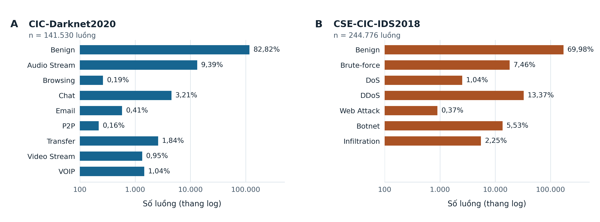
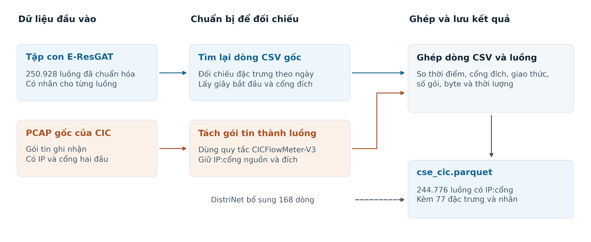
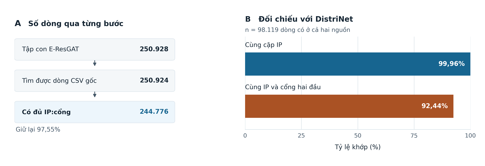
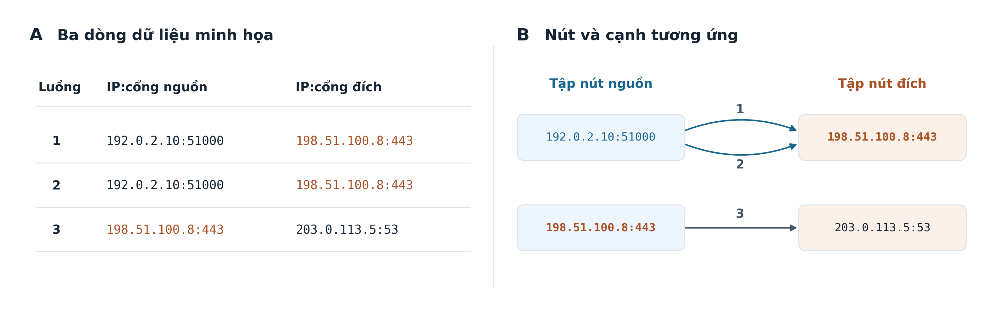

# Dữ liệu tái lập báo cáo ResACAG

Hai ZIP chứa đúng dữ liệu đầu vào của báo cáo. **CIC-Darknet2020** có sẵn IP và cổng. **CSE-CIC-IDS2018** dùng bản tập con đã khôi phục IP:cổng, có thể giải nén và chạy ngay.

**[Tải hai bộ dữ liệu trên Google Drive](https://drive.google.com/drive/folders/1MHJjQueTZs80G7Q2eimJFLOy4kvaodgN?usp=sharing)**

| Tệp | Luồng | Lớp | Đặc trưng đầu vào | Nguồn IP:cổng |
| --- | ---: | ---: | ---: | --- |
| `CIC-Darknet2020.zip` | 141.530 | 9 | 77 | Có sẵn trong `Darknet.csv` |
| `CSE-CIC-IDS2018-recovered-endpoints.zip` | 244.776 | 7 | 77 | Khôi phục từ PCAP của CIC, có bổ sung từ DistriNet |



*Hình 1. Phân bố nhãn trong hai bộ dữ liệu. Trục ngang dùng thang log để thấy rõ các lớp ít mẫu.*

## Khôi phục IP:cổng cho CSE-CIC

Bộ tham chiếu E-ResGAT chứa 250.928 luồng với đặc trưng đã chuẩn hóa. Dữ liệu tham chiếu thiếu thông tin IP:cổng và thời điểm bắt đầu. Nhóm ghép mỗi dòng về CSV gốc của CIC, sau đó tìm luồng tương ứng trong PCAP, tức tệp ghi các gói tin đã quan sát.



*Hình 2. Hai bước ghép để lấy IP:cổng của hai đầu kết nối.*

1. **Tìm lại dòng CSV gốc.** Dùng các dòng Web ngày 22 và 23/02 có thứ tự đã biết để suy ra cách chuẩn hóa của 73/77 cột. Dùng các đặc trưng đó để đối chiếu với CSV theo ngày, tìm được dòng gốc cho 250.924 luồng. CSV gốc cho biết thời điểm bắt đầu và cổng đích.
2. **Ghép dòng CSV với luồng PCAP.** Tách luồng theo quy tắc CICFlowMeter-V3. Gói đầu đặt chiều nguồn → đích. Luồng được chốt khi gặp FIN, khi gói tiếp theo đến sau mốc 120 giây, hoặc khi đọc hết tệp. Để ghép, mã so cổng đích, giao thức, giây bắt đầu theo UTC, số gói và tổng byte tải tin mỗi chiều. Mã thử thời lượng trùng chính xác trước, rồi xét lệch tối đa 20 µs hoặc trường hợp lệch cách đếm gói theo chiều nhưng tổng số gói, số byte mỗi chiều và thời lượng vẫn trùng. Khi cần chọn giữa các ứng viên, mã ưu tiên thời lượng gần nhất và dùng seed 42 để phá hòa.
3. **Ghi bốn trường đầu kết nối.** Giữ `Src IP`, `Src Port`, `Dst IP`, `Dst Port` cùng 77 đặc trưng thô từ CSV gốc và nhãn từ bộ tham chiếu. Trong bản cuối, 243.942 dòng được gán từ PCAP, 666 dòng dùng lại luồng PCAP đã gán và 168 dòng được bổ sung từ DistriNet. `join_tier` ghi cách gán và `join_candidates` ghi số ứng viên PCAP nếu có.



*Hình 3. Giữ lại 97,55% số dòng tham chiếu. Tỷ lệ trùng với DistriNet tính trên 98.119 dòng mà cả hai nguồn đều ghép được.*

Một số dòng có nhiều ứng viên giống nhau về đặc trưng. Đầu kết nối được chọn thuộc một luồng đã ghi nhận, nhưng có thể khác luồng mà E-ResGAT đã lấy mẫu. [Chi tiết quy trình, giới hạn và lệnh dựng lại](../clean_code/code/reproduce/dataset_cse_cic/README.md)

## Từ IP:cổng đến nút và cạnh

Mỗi cặp IP:cổng tạo một nút theo vai trò của nó. Mã lập hai tập nút riêng, **nguồn** và **đích**. Cùng một IP:cổng xuất hiện ở cả hai vai trò thì có hai ID nút. Mỗi dòng tạo một cạnh, kể cả khi nhiều dòng nối cùng cặp nút. IP:cổng xác định cấu trúc đồ thị, còn 77 đặc trưng số và nhãn gắn với từng cạnh.



*Hình 4. Ví dụ với địa chỉ minh họa. Luồng 1 và 2 tạo hai cạnh riêng. Cặp `198.51.100.8:443` thuộc hai tập nút khác nhau tùy vai trò.*

Từ các đầu kết nối đã khôi phục, đồ thị CSE-CIC có 185.642 nút nguồn và 47.196 nút đích. Trong lượt tái hiện chính, **node2vec** lấy mẫu đường đi trên đồ thị để học vector 32 chiều cho mỗi nút, không dùng nhãn. CIC-Darknet dùng đồ thị huấn luyện. CSE-CIC dùng cấu trúc của cả ba tập train, validation và test.

## Giải nén và chạy lại

Lưu hai tệp ZIP từ Google Drive vào `data/` cạnh README này. Sau khi cài các gói trong `requirements.txt`, chạy các lệnh sau từ thư mục chứa `reproduce_report.py`. Hai ZIP giải nén lần lượt vào `data/darknet_original/` và `data/cse_cic/`.

```powershell
Get-FileHash ./data/*.zip -Algorithm SHA256
python -m zipfile -e ./data/CIC-Darknet2020.zip ./data
python -m zipfile -e ./data/CSE-CIC-IDS2018-recovered-endpoints.zip ./data
python clean_code/code/reproduce/verify_data.py --data-root ./data --datasets darknet cse_cic
python reproduce_report.py darknet --data-root ./data
python reproduce_report.py cse-cic --data-root ./data
```

Đối chiếu hash ZIP với [SHA256SUMS.txt](SHA256SUMS.txt). Mỗi bộ có `provenance.json` và trích dẫn nguồn đi kèm. `cse_cic/feature_names.json` ghi thứ tự 77 đặc trưng. [Hướng dẫn chạy các thí nghiệm còn lại](../README.md)

## Nguồn dữ liệu

- CIC-Darknet2020 và bài DIDarknet của Lashkari, Kaur và Rahali. [Bộ dữ liệu](https://www.unb.ca/cic/datasets/darknet2020.html) · [Bài báo](https://doi.org/10.1145/3442520.3442521)
- CSE-CIC-IDS2018 do CSE và CIC công bố. [UNB](https://www.unb.ca/cic/datasets/ids-2018.html) · [AWS Open Data](https://registry.opendata.aws/cse-cic-ids2018/)
- Tập con tham chiếu E-ResGAT và bản trích xuất lại của DistriNet. [E-ResGAT](https://github.com/George730/E-ResGAT/tree/3e0ceb8f73e146eb60041ff122449efacb539769) · [DistriNet](https://intrusion-detection.distrinet-research.be/CNS2022/)
